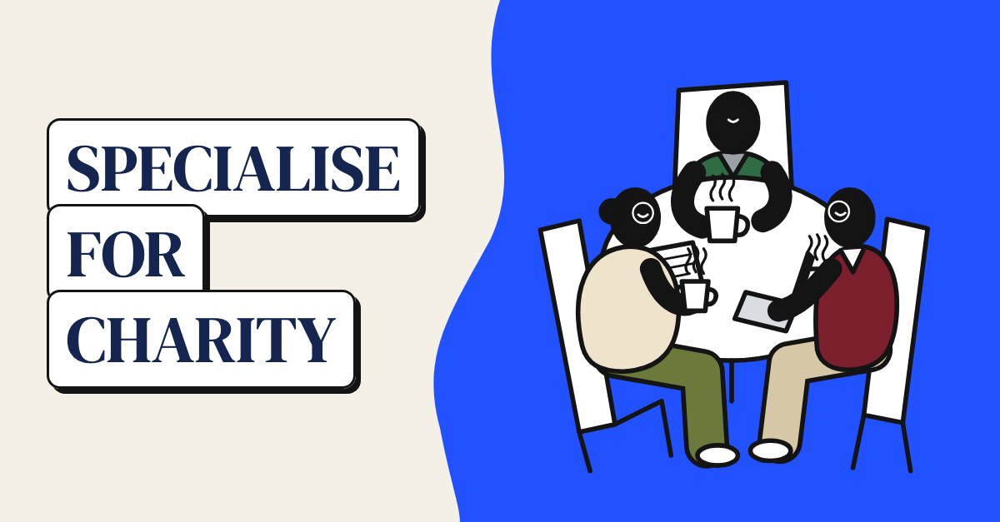
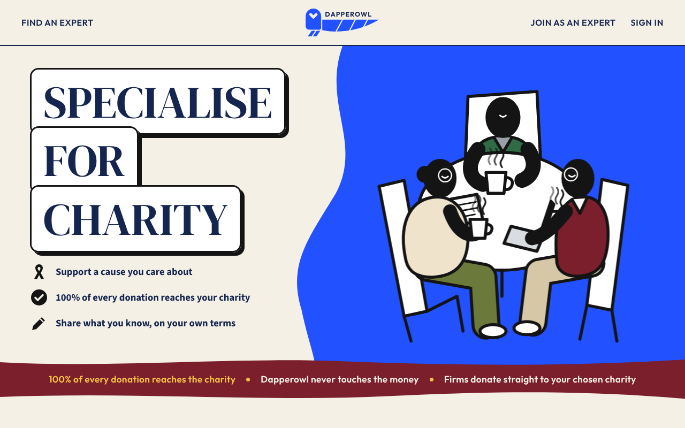
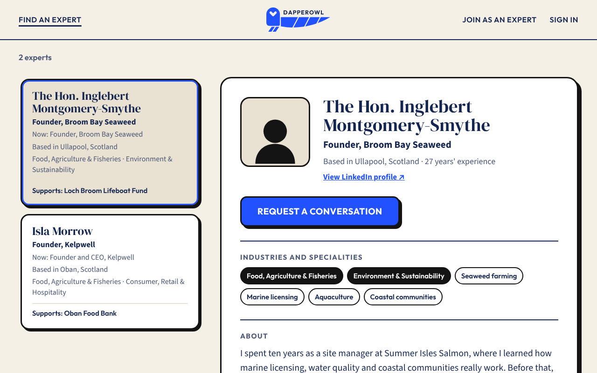
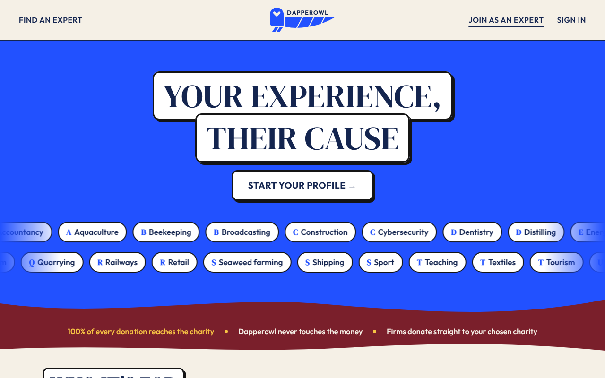
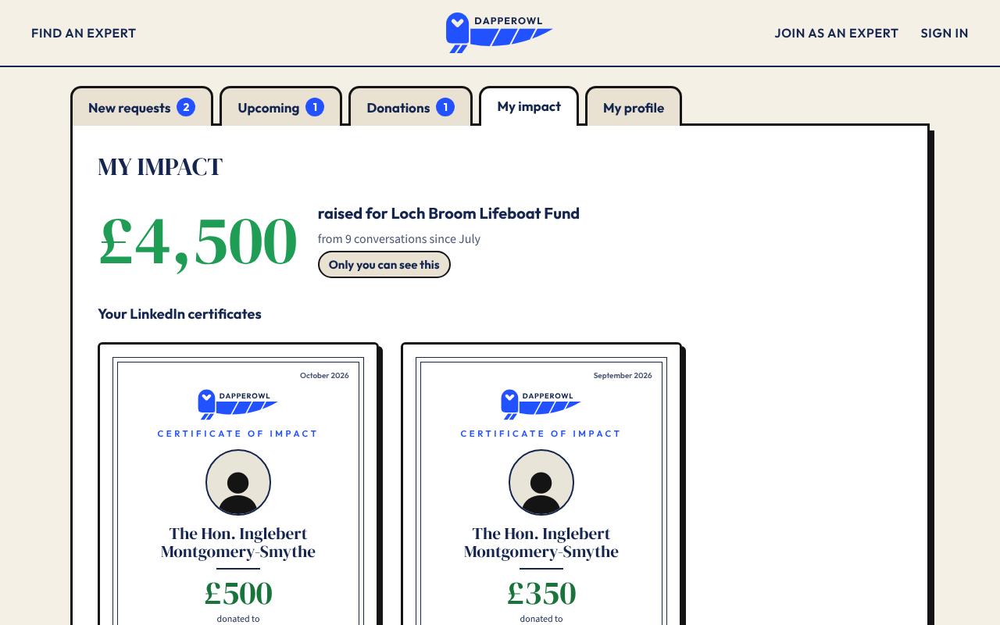
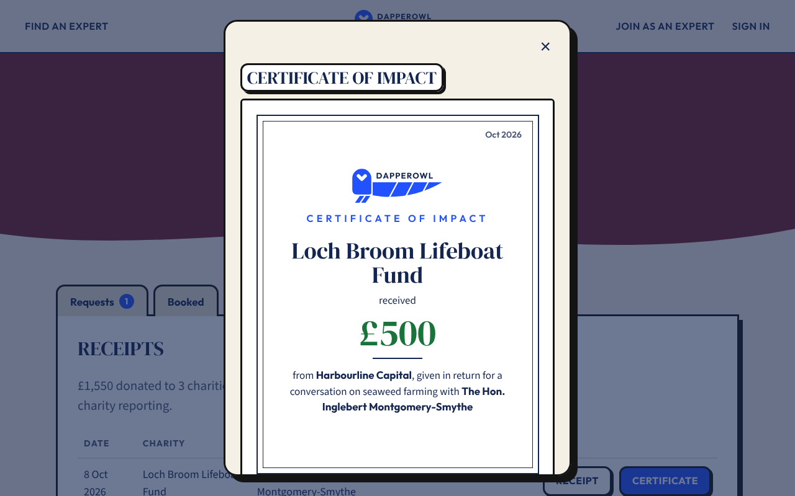

# Dapperowl

**Specialise for charity.** Experts share what they know with organisations that need it. Instead of paying the expert, the organisation donates, in full, to a charity the expert has chosen.

### [▶ Open the live prototype: dapperowl.netlify.app](https://dapperowl.netlify.app)

---

## What it is

Dapperowl is a planned community interest company (CIC): a marketplace that connects people who know their field inside out with firms, investors and organisations looking for that knowledge.

- **Experts** (mostly 40+, still working, retired or specialists in any field) create a profile and choose one UK charity they care about.
- **Firms** search by industry, job or keyword, and send a request with their goals and questions.
- **The donation** goes straight from the firm to the charity's own donation page. **100% reaches the charity. Dapperowl never touches the money.**

No contracts, no selling yourself: just your expertise, put to work for a cause you care about.

## How it works

| | Step | What happens |
|---|---|---|
| 1 | **They ask** | A firm requests a call, written advice, a site visit, a talk or mentoring, and pledges a donation to the expert's charity. |
| 2 | **You share** | The expert accepts or declines. If they accept, they meet and share what they know, on their own terms. |
| 3 | **You send it** | After the meeting, the expert presses **Send** to release the pledged donation. |
| 4 | **Firm paid** | The firm donates directly on the charity's website and uploads its receipt. |
| 5 | **Charity received** | The charity confirms the donation, and both sides get an official **certificate of impact**, optional to share on LinkedIn. |

## Screenshots

| Homepage | Find an expert |
|---|---|
|  |  |
| **Join as an expert** | **Expert dashboard: my impact** |
|  |  |
| **Firm certificate of impact** | |
|  | |

## Try it

Every page is clickable. Good routes to follow:

- **As a firm:** [Find an expert](https://dapperowl.netlify.app/find.html) → search "seaweed" → *Request a conversation* → sign in as a firm → send the request → *My bookings* → donate, upload a receipt and open a certificate.
- **As an expert:** [Sign in](https://dapperowl.netlify.app/signin.html) → *I'm an expert* → *Continue with Google* → review requests, accept or decline, and see *My impact*.
- **Joining:** [Join as an expert](https://dapperowl.netlify.app/join.html) → *Start your profile* → walk through the eight sign-up steps.

## Pages

| Page | File | Purpose |
|---|---|---|
| Homepage | [`index.html`](index.html) | What Dapperowl is, the donation tracker, certificates and an example profile |
| Find an expert | [`find.html`](find.html) | Search and filter experts by industry, job or keyword |
| Join as an expert | [`join.html`](join.html) | Who it's for, how it works, an example profile and FAQs |
| Create your profile | [`create-profile.html`](create-profile.html) | Eight-step sign-up, with CV upload and a drafted career timeline |
| Sign in | [`signin.html`](signin.html) | Emailed sign-in link, Google or LinkedIn, for experts and firms |
| Request a conversation | [`request.html`](request.html) | Goals, questions, format, three times, pledged donation and agreement |
| Expert dashboard | [`expert-dashboard.html`](expert-dashboard.html) | Requests, upcoming meetings, donations, impact and profile |
| Firm dashboard | [`firm-dashboard.html`](firm-dashboard.html) | Requests, bookings, donations to make, receipts and certificates |
| Small print | [`legal.html`](legal.html) | Terms, privacy, code of conduct and cookies |
| Email designs | [`emails.html`](emails.html) | The emails experts and firms receive |

## Design

- **Typefaces:** DM Serif Display (headings), Source Sans 3 (body), Outfit (buttons and labels)
- **Colours:** cream `#F5F0E6` · navy `#14254F` · cobalt `#2251FF` · burgundy `#7A1F2B` · sun `#F6C344` · donation green `#18743A`
- **Style:** bold outlines and hard shadows, wavy colour bands and large, readable text, designed for an audience mostly aged 50+.

## Built with

Plain HTML, CSS and JavaScript with no build step, hosted on [Netlify](https://www.netlify.com/). Shared header, footer and donation tracker live in [`site.js`](site.js); design tokens and components live in [`styles.css`](styles.css).

## Status

This is a **clickable prototype with invented sample data**. The people, firms and charities shown are fictional, and no sign-ins, payments or emails are real. The full site (accounts, database and email sending) is planned next. *Dapperowl* is a working name.

---

© 2026 Dapperowl CIC (in formation) · Made by <a href="https://github.com/Luke-W-L-M">Luke Melville</a>

